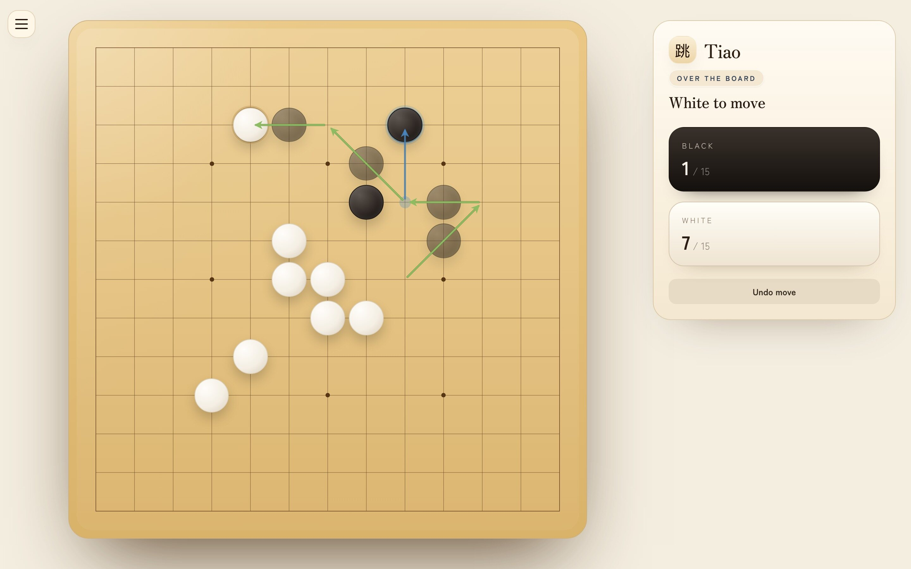
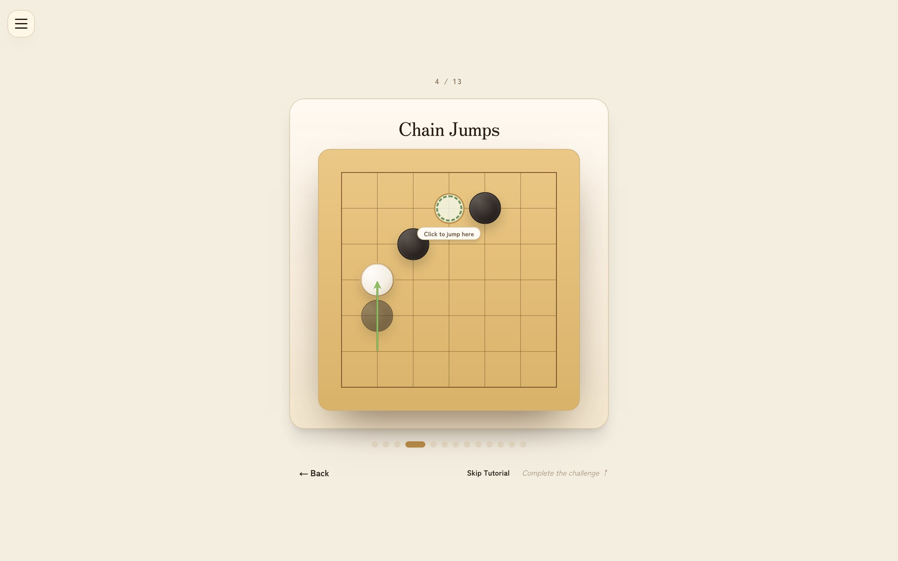
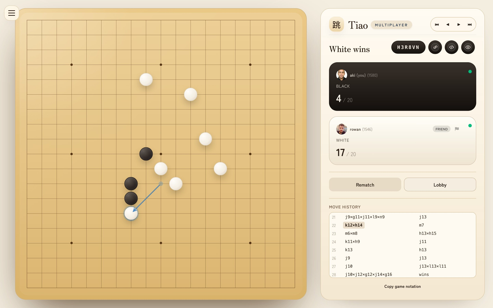
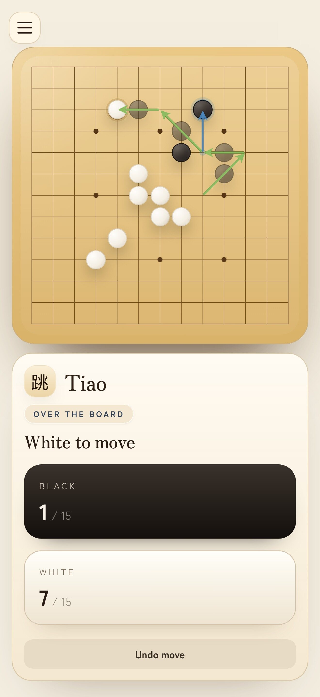

# Tiao

**Tiao** (跳, "jump") is a two-player strategy board game where one capture can chain into the next. Play it free in your browser at **[playtiao.com](https://playtiao.com)**.

Each turn you do one thing: place a stone on an empty point, or jump one of your stones over an enemy stone to capture it. If the stone can jump again from where it lands, it keeps going, so one move can capture several stones. The first player to capture 10 stones wins. There is no luck and no hidden information. Andreas Edmeier designed the game.

Play against the computer on three levels, with a friend on one screen, or online against people near your rating. You need no account to start, and you can sign up later to keep your rating, game history, friends and achievements. This repository holds all of it: the web game, the game server, the shared rules engine, and the desktop and mobile apps.



## How to play

```
  Place a stone:          Jump to capture:

  . . . . .              . . . . .         . . . . .
  . . . . .              . W . . .         . . . . .
  . . W . .              . . B . .   -->   . . x . .
  . . . . .              . . . . .         . . . W .
  . . . . .              . . . . .         . . . . .
```

Jumps go in any of eight directions. After a jump, the same stone may jump again, and you confirm the chain to end your turn. Two placement rules keep stones exposed: a connected group can't grow past 10 stones, and you can place on the edge only where an enemy stone could jump to it. The [complete rules](docs/GAME_RULES.md) have diagrams for each case.

<p>
  
  
</p>

## What is in the game

- **Computer opponent** on Easy, Intermediate or Hard. Choose your colour, a 9×9, 13×13 or 19×19 board, and a target of 5, 10, 15 or 20 captures.
- **Same-screen games** for two people on one device.
- **Online games** with matchmaking that pairs players by Elo rating, private invite links, spectators, takebacks and rematches.
- **Tournaments** with brackets.
- **Friends**: find players by name, send requests, invite friends to a game.
- **Game history** with move-by-move replay and copyable game notation.
- **Profiles** with rating, badges and 30 achievements.
- **Board themes**: Classic for everyone, plus Night, Sakura, Ocean and Marble in the optional shop.
- **An interactive tutorial** that teaches the rules on small boards.
- **English, German and Spanish.**
- **Accounts** with email and password or GitHub, Google, Discord or Apple sign-in. Guests can play without one.

## Run it locally

You need Node.js 24 (see `.nvmrc`), pnpm 10 and Docker.

```bash
git clone https://github.com/trebeljahr/tiao.git
cd tiao
corepack enable                          # provides the pnpm version from package.json
SKIP_DESKTOP=1 SKIP_MOBILE=1 pnpm install   # leave out the two variables to also install the desktop and mobile apps
pnpm dev:infra                           # MongoDB, Redis and RustFS (S3-compatible storage) in Docker
pnpm dev                                 # client and server with hot reload
```

`pnpm dev` picks free random ports and prints the URLs. It starts MongoDB and Redis itself if they are not running. You need no `.env` file: `server/.env.development` points at the local Docker containers. To override a value, create `server/.env`. The RustFS console is at `http://localhost:9001/rustfs/console/` (user and password: `minioadmin`).

| Command                 | What it does                                                 |
| ----------------------- | ------------------------------------------------------------ |
| `pnpm dev`              | Client and server with hot reload, on random ports           |
| `pnpm dev:fixed`        | The same on fixed ports (client 3000, server 5005)           |
| `pnpm dev:lan`          | Fixed ports, reachable from other devices on your network    |
| `pnpm dev:docs`         | Client, server and the Docusaurus docs site                  |
| `pnpm dev:infra`        | Start MongoDB, Redis and RustFS containers                   |
| `pnpm dev:infra:stop`   | Stop the containers and keep their data                      |
| `pnpm dev:infra:reset`  | Stop the containers and delete their data                    |
| `pnpm dev:desktop`      | Local server plus the native desktop app                     |
| `pnpm test:unit`        | Unit tests for server, client and desktop scripts            |
| `pnpm test:e2e`         | Build the client and run the Playwright end-to-end tests     |
| `pnpm typecheck`        | TypeScript checks for client and server                      |
| `pnpm lint`             | Biome lint                                                   |
| `pnpm format`           | Biome format                                                 |

[docs/TESTING.md](docs/TESTING.md) explains the test harnesses.

## Desktop and mobile apps



The desktop app uses Tauri 2 to host the same static web build on Windows, macOS and Linux. Rust handles sign-in, deep links, stored credentials, Steam and store purchases. API calls go to `TIAO_API_URL` (default `https://api.playtiao.com`).

```sh
pnpm dev:desktop          # local server on a free port plus the native app
pnpm dev:desktop:prod     # native app against the production API
pnpm --dir desktop package   # unsigned packages for your platform
```

Each distribution channel (direct download, Steam, Mac App Store, Microsoft Store) builds into its own binary, and store builds never update themselves. See [desktop/README.md](desktop/README.md) and [docs/RELEASING-desktop.md](docs/RELEASING-desktop.md).

The iOS and Android apps wrap the same client with Capacitor. See [mobile/README.md](mobile/README.md) and [docs/releasing-mobile.md](docs/releasing-mobile.md).

<br clear="right">

## Project structure

```
tiao/
├── client/      Next.js + React + Tailwind web client
├── server/      Express + WebSocket game server
├── shared/      Rules engine, protocol types and achievement definitions
├── desktop/     Tauri desktop app (direct download, stores, Steam)
├── mobile/      Capacitor iOS and Android apps
├── e2e/         Playwright end-to-end tests
├── scripts/     Dev server, screenshot, store-media and release scripts
├── docs/        Rules, architecture, API, testing and release guides
└── docs-site/   Docusaurus documentation site
```

The rules engine (`shared/src/tiao.ts`) is a set of pure functions. The server and the client both use it to validate and apply moves.

## Tech stack

TypeScript throughout. Next.js 16 with React 19, Tailwind CSS 4 and next-intl on the client. Express 5, `ws`, Mongoose and better-auth on the server, with Redis optional. Tauri 2 (Rust) for desktop, Capacitor 8 for mobile. Vitest, the Node.js test runner and Playwright for tests, Biome for linting and formatting.

## Documentation

| Document                                         | What it covers                                     |
| ------------------------------------------------ | -------------------------------------------------- |
| [docs/GAME_RULES.md](docs/GAME_RULES.md)         | Complete rules with diagrams                       |
| [docs/ARCHITECTURE.md](docs/ARCHITECTURE.md)     | System design, data flow and technical decisions   |
| [docs/API.md](docs/API.md)                       | REST and WebSocket API                             |
| [docs/TESTING.md](docs/TESTING.md)               | Test harnesses and how to add tests                |
| [docs/DEPLOYMENT.md](docs/DEPLOYMENT.md)         | Production shape, environment variables and CI/CD  |
| [docs/coolify-deployment.md](docs/coolify-deployment.md) | Self-hosting the game server with Coolify  |
| [docs/marketing/README.md](docs/marketing/README.md) | Screenshots, social preview and how to regenerate them |
| [CONTRIBUTING.md](CONTRIBUTING.md)               | Setup, conventions and pull requests               |

## Contributing

Bug reports, ideas and pull requests are welcome. [CONTRIBUTING.md](CONTRIBUTING.md) covers setup, coding conventions and how to submit a change. Questions go to [Discussions](https://github.com/trebeljahr/tiao/discussions), and security reports go through [SECURITY.md](.github/SECURITY.md).

## Support

Tiao is free and has no ads. If you want to support its development, you can [donate here](https://ricos.site/donate?from=tiao).

## License

The code is licensed under the [GNU Affero General Public License v3.0](LICENSE), with one additional permission: the desktop build may be linked against the proprietary Steamworks SDK. [LICENSE-EXCEPTIONS.md](LICENSE-EXCEPTIONS.md) has the grant and the reasoning. Contributions are accepted under the AGPL-3.0 and that exception together.

The license covers the code. The game rules are Andreas Edmeier's work. The interface fonts, Zen Old Mincho and Zen Kaku Gothic New, are under the SIL Open Font License 1.1. The trailer audio in `scripts/assets/store-trailer/audio/` lists its sources and licenses in [credits.json](scripts/assets/store-trailer/audio/credits.json).
